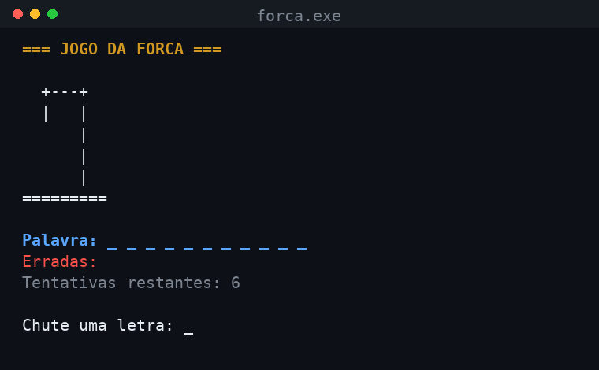
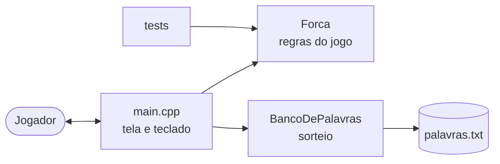

<h1 align="center">🎯 Jogo da Forca em C++</h1>

<p align="center">
  <a href="https://github.com/b4el/jogo-da-forca/actions/workflows/build.yml"></a>
  
  
  
  <a href="LICENSE"></a>
</p>

<p align="center">
  Jogo da forca clássico para o terminal, feito para estudar C++ moderno:<br>
  classes, organização em vários arquivos, testes automatizados e integração contínua.
</p>

<p align="center">
  
</p>

---

## 📋 Sumário

- [Como jogar](#-como-jogar)
- [Funcionalidades](#-funcionalidades)
- [Como compilar e rodar](#%EF%B8%8F-como-compilar-e-rodar)
- [Estrutura do projeto](#-estrutura-do-projeto)
- [Testes](#-testes)
- [O que aprendi](#-o-que-aprendi)
- [Próximos passos](#-próximos-passos)

## 🎮 Como jogar

1. O jogo sorteia uma palavra secreta e mostra um `_` para cada letra.
2. Você chuta **uma letra por vez**.
3. Acertou? A letra aparece em todas as posições da palavra.
4. Errou? Uma parte do boneco é desenhada.
5. Descubra a palavra antes de completar **6 erros**!

## ✨ Funcionalidades

- 🎲 Palavras sorteadas a partir de [`data/palavras.txt`](data/palavras.txt) (edite para adicionar as suas)
- 🧍 Boneco desenhado em ASCII a cada erro
- ⚠️ Avisa quando você repete uma letra ou digita algo que não é letra (sem perder tentativa)
- 🔠 Maiúsculas e minúsculas tanto faz
- 🔁 Várias partidas seguidas
- 🛟 Se o arquivo de palavras não existir, usa uma lista padrão

## ⚙️ Como compilar e rodar

**Pré-requisitos:** um compilador C++17 (Visual Studio 2019+, GCC 8+ ou Clang 7+) e CMake 3.16+.

### Visual Studio (Windows)

1. **Arquivo → Abrir → Pasta...** e selecione a pasta do projeto.
2. O Visual Studio detecta o `CMakeLists.txt` e configura tudo sozinho.
3. Ao lado do botão ▶, escolha **forca.exe** e pressione **Ctrl + F5**.

### Linha de comando

```bash
git clone https://github.com/b4el/jogo-da-forca.git
cd jogo-da-forca
cmake -S . -B build
cmake --build build

./build/forca              # Linux / macOS
build\Debug\forca.exe      # Windows
```

## 📁 Estrutura do projeto

```
jogo-da-forca/
├── include/                 # Cabeçalhos: a "interface" de cada classe
│   ├── Forca.h
│   └── BancoDePalavras.h
├── src/
│   ├── Forca.cpp            # Regras do jogo
│   ├── BancoDePalavras.cpp  # Leitura e sorteio das palavras
│   └── main.cpp             # Interface de terminal
├── tests/test_forca.cpp     # Testes automatizados
├── data/palavras.txt        # Lista de palavras
├── docs/demo.gif            # Animação deste README
├── CMakeLists.txt           # Configuração de build
└── .github/workflows/       # CI: compila e testa a cada push
```

A ideia principal da arquitetura: a classe **`Forca` só conhece as regras** — ela não lê o teclado nem imprime nada. Quem conversa com o usuário é o `main.cpp`. Essa separação deixa o código mais organizado e permite testar a lógica automaticamente.



## 🧪 Testes

Os testes ficam em [`tests/test_forca.cpp`](tests/test_forca.cpp) e verificam acertos, erros, letras repetidas, vitória, derrota e entradas inválidas.

```bash
ctest --test-dir build --output-on-failure
```

Eles também rodam automaticamente no **GitHub Actions** (Windows e Linux) a cada push — é isso que o selo **Build** lá em cima mostra.

## 📚 O que aprendi

- Separar código em **cabeçalhos (`.h`) e implementações (`.cpp`)**
- Criar **classes** com dados privados e métodos públicos
- Usar `enum class`, `std::set`, `std::vector` e `<random>`
- Ler arquivos com `std::ifstream`
- Configurar um projeto com **CMake**
- Escrever **testes automatizados** e rodar com **CTest**
- Configurar **integração contínua** com GitHub Actions

## 🚀 Próximos passos

- [ ] Categorias de palavras (frutas, animais, países...)
- [ ] Dica para cada palavra
- [ ] Placar salvo em arquivo
- [ ] Suporte a palavras com acento
- [ ] Modo dois jogadores (um escolhe a palavra, o outro adivinha)

## 📄 Licença

Distribuído sob a licença MIT. Veja [`LICENSE`](LICENSE).

---

<p align="center">Feito por <a href="https://github.com/b4el">Gabriel Leandro</a> enquanto estudava C++ 🤙</p>
