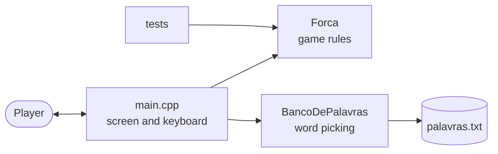

<h1 align="center">🎯 Hangman in C++ <sub>(Jogo da Forca)</sub></h1>

<p align="center">
  <a href="https://github.com/b4el/jogo-da-forca/actions/workflows/build.yml"></a>
  
  
  
  <a href="LICENSE"></a>
</p>

<p align="center">
  The classic hangman game for the terminal, built to practice modern C++:<br>
  classes, multi-file organization, automated tests and continuous integration.
</p>

<p align="center">
  
</p>

> *Note: the game itself (words and messages) and the code comments are in Brazilian Portuguese.*

---

## 📋 Contents

- [How to play](#-how-to-play)
- [Features](#-features)
- [Building and running](#%EF%B8%8F-building-and-running)
- [Project structure](#-project-structure)
- [Tests](#-tests)
- [What I learned](#-what-i-learned)
- [Next steps](#-next-steps)

## 🎮 How to play

1. The game picks a secret word and shows a `_` for each letter.
2. You guess **one letter at a time**.
3. Right guess? The letter shows up in every position where it appears.
4. Wrong guess? Another part of the stick figure is drawn.
5. Find the word before you make **6 mistakes**!

## ✨ Features

- 🎲 Random words from [`data/palavras.txt`](data/palavras.txt) (edit it to add your own)
- 🧍 ASCII stick figure drawn with each mistake
- ⚠️ Warns you about repeated letters or anything that is not a letter (without costing a guess)
- 🔠 Case-insensitive input
- 🔁 Play several rounds in a row
- 🛟 Falls back to a built-in word list if the word file is missing

## ⚙️ Building and running

**Requirements:** a C++17 compiler (Visual Studio 2019+, GCC 8+ or Clang 7+) and CMake 3.16+.

### Visual Studio (Windows)

1. **File → Open → Folder...** and pick the project folder.
2. Visual Studio detects `CMakeLists.txt` and configures everything automatically.
3. Next to the ▶ button, choose **forca.exe** and press **Ctrl + F5**.

### Command line

```bash
git clone https://github.com/b4el/jogo-da-forca.git
cd jogo-da-forca
cmake -S . -B build
cmake --build build

./build/forca              # Linux / macOS
build\Debug\forca.exe      # Windows
```

## 📁 Project structure

```
jogo-da-forca/
├── include/                 # Headers: the "interface" of each class
│   ├── Forca.h
│   └── BancoDePalavras.h
├── src/
│   ├── Forca.cpp            # Game rules
│   ├── BancoDePalavras.cpp  # Loading and picking words
│   └── main.cpp             # Terminal interface
├── tests/test_forca.cpp     # Automated tests
├── data/palavras.txt        # Word list
├── docs/demo.gif            # Animation used in this README
├── CMakeLists.txt           # Build configuration
└── .github/workflows/       # CI: builds and tests on every push
```

The core architectural idea: the **`Forca` class only knows the rules**. It never reads the keyboard or prints anything; talking to the player is `main.cpp`'s job. This separation keeps the code organized and makes the game logic easy to test automatically.



## 🧪 Tests

The tests live in [`tests/test_forca.cpp`](tests/test_forca.cpp) and cover right and wrong guesses, repeated letters, winning, losing and invalid input.

```bash
ctest --test-dir build --output-on-failure
```

They also run automatically on **GitHub Actions** (Windows and Linux) on every push; that is what the **Build** badge at the top shows.

## 📚 What I learned

- Splitting code into **headers (`.h`) and implementations (`.cpp`)**
- Writing **classes** with private data and public methods
- Using `enum class`, `std::set`, `std::vector` and `<random>`
- Reading files with `std::ifstream`
- Setting up a project with **CMake**
- Writing **automated tests** and running them with **CTest**
- Setting up **continuous integration** with GitHub Actions

## 🚀 Next steps

- [ ] Word categories (fruits, animals, countries...)
- [ ] A hint for each word
- [ ] Scoreboard saved to a file
- [ ] Support for accented words
- [ ] Two-player mode (one picks the word, the other guesses)

## 📄 License

Released under the MIT License. See [`LICENSE`](LICENSE).

---

<p align="center">Made by <a href="https://github.com/b4el">Gabriel Leandro</a> while learning C++ 🤙</p>
