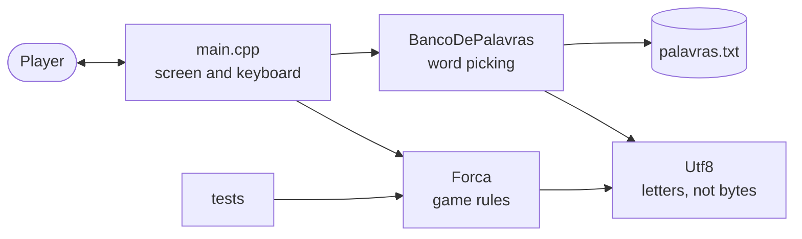

<h1 align="center">🎯 Hangman in C++ <sub>(Jogo da Forca)</sub></h1>

<p align="center">
  <a href="https://github.com/b4el/jogo-da-forca/actions/workflows/build.yml"></a>
  <a href="https://github.com/b4el/jogo-da-forca/actions/workflows/qualidade.yml"></a>
  
  
  
  <a href="LICENSE"></a>
</p>

<p align="center">
  The classic hangman game for the terminal, built to practice modern C++:<br>
  classes, multi-file organization, proper UTF-8 handling, automated tests and continuous integration.
</p>

<p align="center">
  
</p>

> *Note: the game itself (words and messages) and the code comments are in Brazilian Portuguese.*

---

## 📋 Contents

- [How to play](#-how-to-play)
- [Features](#-features)
- [Building and running](#%EF%B8%8F-building-and-running)
- [Project structure](#-project-structure)
- [Accents and UTF-8](#-accents-and-utf-8)
- [Tests and code quality](#-tests-and-code-quality)
- [What I learned](#-what-i-learned)
- [Next steps](#-next-steps)

## 🎮 How to play

1. The game picks a secret word and shows a `_` for each letter.
2. You guess **one letter at a time**.
3. Right guess? The letter shows up in every position where it appears.
4. Wrong guess? Another part of the stick figure is drawn.
   Accents don't matter: guessing **A** reveals A, Á, Â and Ã; guessing **C** reveals Ç.
5. Find the word before you make **6 mistakes**!

## ✨ Features

- 🎲 Random words from [`data/palavras.txt`](data/palavras.txt) (edit it to add your own)
- 🇧🇷 Full support for accented words (CORAÇÃO, MAÇÃ, ÔNIBUS...), read and displayed correctly on Windows and Linux
- 🧍 ASCII stick figure drawn with each mistake
- ⚠️ Warns you about repeated letters or anything that is not a letter (without costing a guess)
- 🔠 Case-insensitive input
- 🔁 Play several rounds in a row
- 🛟 Falls back to a built-in word list if the word file is missing

## ⚙️ Building and running

**Requirements:** a C++17 compiler (Visual Studio 2019+, GCC 8+ or Clang 7+), CMake 3.16+ and Git (CMake downloads GoogleTest the first time you configure the project).

### Visual Studio (Windows)

1. **File → Open → Folder...** and pick the project folder.
2. Visual Studio detects `CMakeLists.txt` and configures everything automatically.
3. Next to the ▶ button, choose **forca.exe** and press **Ctrl + F5**.

### Command line

```bash
git clone https://github.com/b4el/jogo-da-forca.git
cd jogo-da-forca
cmake -S . -B build
cmake --build build

./build/forca              # Linux / macOS
build\Debug\forca.exe      # Windows
```

## 📁 Project structure

```
jogo-da-forca/
├── include/                 # Headers: the "interface" of each class
│   ├── Forca.h
│   ├── BancoDePalavras.h
│   └── Utf8.h               # UTF-8 decoding/encoding and accent handling
├── src/
│   ├── Forca.cpp            # Game rules
│   ├── BancoDePalavras.cpp  # Loading and picking words
│   ├── Utf8.cpp
│   └── main.cpp             # Terminal interface
├── tests/                   # GoogleTest tests (game rules, UTF-8, word file)
├── data/palavras.txt        # Word list
├── docs/demo.gif            # Animation used in this README
├── CMakeLists.txt           # Build configuration
└── .github/workflows/       # CI: build + code quality on every push
```

The core architectural idea: the **`Forca` class only knows the rules**. It never reads the keyboard or prints anything; talking to the player is `main.cpp`'s job. This separation keeps the code organized and makes the game logic easy to test automatically.



## 🇧🇷 Accents and UTF-8

A `std::string` stores **bytes**, not letters. In UTF-8, plain letters take 1 byte but accented ones take more: `"CORAÇÃO"` has **7 letters but 9 bytes**, so `palavra[5]` is only half of the `Ç`. Treating bytes as letters would break the masked word, the letter count and every comparison.

The game solves this in [`Utf8.h`](include/Utf8.h):

1. **Decode** the UTF-8 text into `std::u32string`, where each `char32_t` is one full letter (a Unicode code point). Invalid input, like a word file saved in Latin-1, is rejected instead of silently corrupting the game.
2. Compare guesses by **base letter** (`Ã → A`, `Ç → C`), so players can type without accents.
3. **Encode** back to UTF-8 only when showing text on screen.

On Windows the console is switched to UTF-8 at startup (`SetConsoleOutputCP(CP_UTF8)`), and the project is compiled with `/utf-8` so accented string literals are stored correctly by MSVC.

## 🧪 Tests and code quality

20 **GoogleTest** tests cover the game rules, the accent rules (`"A"` revealing `Ã`, accented guesses, letter count vs byte count), the UTF-8 decoder (including invalid and overlong sequences) and the word file reader (BOM, Windows line endings, wrong encodings).

```bash
ctest --test-dir build --output-on-failure
```

Every push runs two GitHub Actions workflows:

| Workflow | What it checks |
|---|---|
| **Build** | Compiles and runs the tests on **Windows (MSVC)** and **Linux (GCC)** |
| **Code quality** | **clang-format** (style), **clang-tidy** (static analysis, warnings are errors) and an **AddressSanitizer + UBSan** build that runs the tests and a full scripted game |

Locally: `clang-format --dry-run --Werror include/*.h src/*.cpp tests/*.cpp`, `run-clang-tidy -p build "/src/[^/]+\.cpp$"` and `cmake -S . -B build-asan -DFORCA_SANITIZERS=ON`.

## 📚 What I learned

- Splitting code into **headers (`.h`) and implementations (`.cpp`)**
- Writing **classes** with private data and public methods
- Using `enum class`, `std::set`, `std::vector` and `<random>`
- Reading files with `std::ifstream`
- How **UTF-8** works: bytes vs. code points, decoding, validation and Unicode letter mapping
- Setting up a project with **CMake**
- Writing **automated tests** with **GoogleTest** and running them with **CTest**
- Keeping code clean with **clang-format**, **clang-tidy** and **sanitizers**
- Setting up **continuous integration** with GitHub Actions

## 🚀 Next steps

- [ ] Word categories (fruits, animals, countries...)
- [ ] A hint for each word
- [ ] Scoreboard saved to a file
- [x] Support for accented words
- [ ] Two-player mode (one picks the word, the other guesses)

## 📄 License

Released under the MIT License. See [`LICENSE`](LICENSE).

---

<p align="center">Made by <a href="https://github.com/b4el">Gabriel Leandro</a> while learning C++ 🤙</p>
